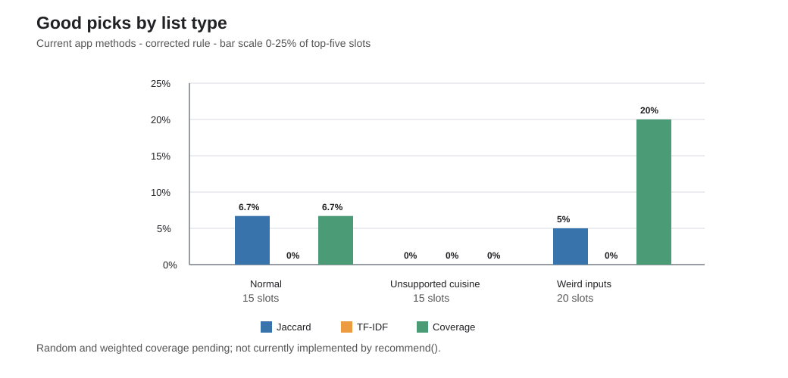

# Hidden-list evaluation — provisional

## Good-result rule

A recipe is good only when it matches at least two of the user's ingredients and has no more than three missing non-basic ingredients.

## Results table

The denominator includes all five top-result slots per list, including slots for which the app returned no recommendation.

| App method | Normal lists (15 slots) | Unsupported cuisines (15 slots) | Weird inputs (20 slots) | Overall (50 slots) |
|---|---:|---:|---:|---:|
| Jaccard | 1/15 (6.7%) | 0/15 (0%) | 1/20 (5%) | 2/50 (4%) |
| TF-IDF | 0/15 (0%) | 0/15 (0%) | 0/20 (0%) | 0/50 (0%) |
| Coverage | 1/15 (6.7%) | 0/15 (0%) | 4/20 (20%) | 5/50 (10%) |

## What these scores mean

Each method is judged on 50 possible top-five slots (10 lists x 5 picks); a missing recommendation counts as not good. These percentages are precision under the stated good-result rule, not recipe accuracy, a probability that a recipe is useful, or a measure of how confident the ranking score is. Jaccard, TF-IDF, and coverage scores are ranking signals; the good-pick percentages come from applying the separate rubric to each returned recipe.

## What we learned and changed

1. **A missing-ingredients-only rule overcounted plausible results.** It would have marked 15 picks good; the two-match minimum disqualifies 8 of them, all from unsupported-cuisine lists. **Changed:** the evaluator now requires two distinct pantry ingredients to match, as well as no more than three missing non-basic ingredients.
2. **The recipe catalog is the main limitation for unsupported cuisines.** None of the 45 slots across those lists is good, even though several recipes share one or two ingredients. **Changed:** results are now split by list type in the summary table and chart so catalog gaps are visible instead of blended into the overall score. Recipe coverage itself remains future work.
3. **Odd inputs can still produce misleading-looking results.** The app returned one TF-IDF result for the random-text list with zero matched pantry ingredients; the new rule marks it not good. Coverage had the strongest weird-input result (4/20). **Changed:** evaluation now calls the same `recommend()` API as the app and records the matched pantry count for each result.

## Pending comparisons

These are provisional results from the current `recommend()` methods only. Random and weighted coverage are not implemented in the shared recommender, so they were not run while Mikayla's ranking work is incomplete. Seth's independent marks are also absent (0 of 133 returned recommendations marked); agreement cannot yet be calculated and there are no differences to settle.
