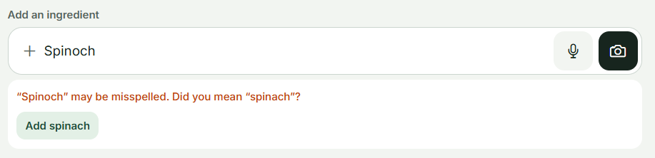
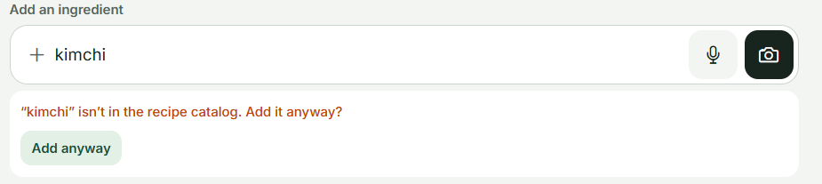

# FridgeChef screenshots

## Ingredient spelling validation

Captured 2026-11-22. The app flags “Spinoch” as a likely misspelling and offers “Add spinach” as a correction.

## Unlisted ingredient confirmation

Captured 2026-11-22. The app asks for confirmation before adding “kimchi,” which is not in the current recipe catalog.

